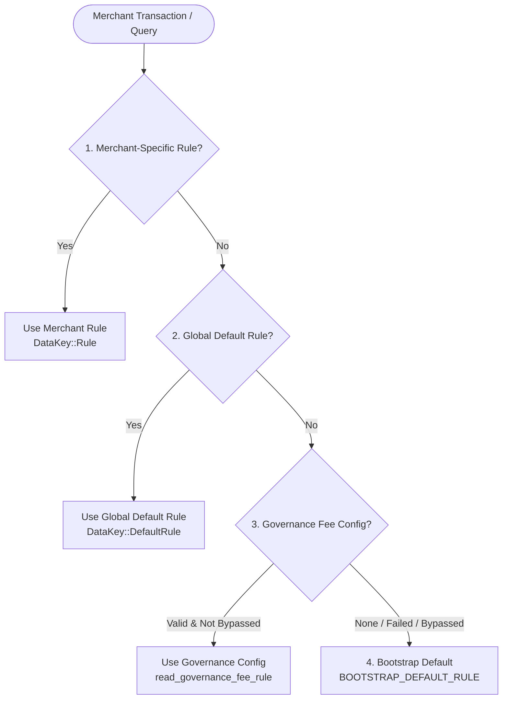

# Bootstrap Fallback Semantics

This document describes the bootstrap settlement fallback mechanism, the complete fallback resolution chain, its trigger conditions, and the event emission rules in the BettaPay settlement contract (`settlement_contract`).

---

## 1. Motivation and Purpose

When a BettaPay settlement contract is freshly deployed, neither per-merchant rules nor a global default rule are initially configured. Rather than requiring complex multi-step transaction bundling during deployment or failing transactions when configuration is absent, the settlement contract provides a fail-safe fallback: `BOOTSTRAP_DEFAULT_RULE`.

This ensures:
- **Zero-Config Usability**: Deployments can immediately process transactions under conservative, secure defaults.
- **Resilience Against Governance Outages**: If the governance contract is temporarily unreachable, broken, or intentionally bypassed, payments continue uninterrupted by falling back through the chain.
- **Observability**: When payments fall back to the unconfigured bootstrap defaults, an explicit `bootstrap_fallback` event is published so operators and off-chain indexers can detect the configuration gap.

---

## 2. The Four-Tier Fallback Chain

When determining the effective settlement rule for a merchant (e.g. during payment storage, fee calculation, or rule queries), the contract resolves through a strict four-tier hierarchy:



### Tier 1: Merchant-Specific Override
- **Storage**: Persistent storage under `DataKey::Rule(Address)`.
- **Set by**: Admin multisig via `set_settlement_rule(signers, merchant, rule)`.
- If present, this rule takes precedence over all shared or global configurations.

### Tier 2: Global Default Rule
- **Storage**: Instance storage under `DataKey::DefaultRule`.
- **Set by**: Admin multisig via `set_default_rule(signers, new_rule)`.
- If no merchant override is set, this administrator-configured protocol default applies.

### Tier 3: Governance Protocol Fee Config
- **Source**: Cross-contract invocation to `governance.get_fee_config()`.
- **Cached / Fetched**: Read via `read_governance_fee_rule(env)`.
- **Timing & Auto-settle Synthesis**: Governance only manages fee ceilings (`platform_fee_bps` and `network_fee_bps`). When synthesized into a `SettlementRule`, operational parameters default to:
  - `settlement_delay_ledger = 0` (immediate settlement readiness).
  - `auto_settle = false` (no automatic batch settlement).
- **Graceful Degradation**: If governance is unconfigured (`None`), if the cross-contract call traps or fails with a host error, or if the governance circuit breaker is enabled (`bypass_gov_fees == 1`), this tier yields `None` and execution falls through to Tier 4.

### Tier 4: Bootstrap Default Rule
- **Source**: Hardcoded compile-time constant `BOOTSTRAP_DEFAULT_RULE` in `settlement_contract::policy`.
- Terminal fallback when tiers 1, 2, and 3 are absent or unavailable.

---

## 3. Bootstrap Rule Field Values

The `BOOTSTRAP_DEFAULT_RULE` is defined as follows:

```rust
pub const BOOTSTRAP_DEFAULT_RULE: SettlementRule = SettlementRule {
    platform_fee_bps: 100,
    network_fee_bps: MIN_FEE_BPS, // 5 bps
    settlement_delay_ledger: 0,
    auto_settle: false,
};
```

| Field | Value | Human Scale | Rationale |
|---|---|---|---|
| `platform_fee_bps` | `100` | $1.00\%$ | Reasonable, conservative baseline platform fee for unconfigured deployments. |
| `network_fee_bps` | `5` | $0.05\%$ | Exact protocol floor (`MIN_FEE_BPS`), preventing sub-minimum fee charges. |
| `settlement_delay_ledger` | `0` | $0$ ledgers | Immediate readiness; avoids unexpectedly timelocking payments in default state. |
| `auto_settle` | `false` | Disabled | Opt-in batching; prevents unconfigured automatic payouts off-chain. |

---

## 4. Trigger Conditions for Bootstrap Fallback

The bootstrap fallback is triggered if and only if **all** of the following conditions are met:
1. **No Merchant Rule**: No entry exists under `DataKey::Rule(merchant)` in persistent storage.
2. **No Default Rule**: No entry exists under `DataKey::DefaultRule` in instance storage.
3. **Governance Fee Config Unavailable**: Any of the following:
   - The governance contract address is unconfigured or zero.
   - Governance `get_fee_config()` returns `None`.
   - Governance `get_fee_config()` panics, traps, reverts, or exceeds gas limits.
   - The governance fee bypass parameter (`bypass_gov_fees`) is set to `1`.

---

## 5. Event Emission Semantics

Emitting an on-chain event consumes execution compute and ledger history. The contract therefore strictly separates mutating payment paths from read-only query paths:

| Entry Point | Execution Kind | Resolves Fallback? | Emits `bootstrap_fallback`? | Rationale |
|---|---|---|---|---|
| `store_payment_reference` | **Mutating** (State Write) | Yes | **Yes** (when resolved rule equals bootstrap) | Signals to monitors and indexers that live user funds were processed under bootstrap defaults. |
| `calculate_fee_split` | **Read-Only** (Dry Run) | Yes | **No** | Preview/dry-run calculations must be side-effect free and cannot pollute event logs. |
| `get_effective_rule` | **Read-Only** (Query) | Yes | **No** | Public queries must remain side-effect free and TTL-neutral. |
| `clear_settlement_rule` | **Mutating** (Admin Action) | Yes (`read_fallback_rule`) | **No** | The newly effective fallback rule is embedded directly into the `settlement_rule_cleared` event payload. |
| `unregister_merchant` | **Mutating** (Admin Action) | Yes (`read_fallback_rule`) | **No** | The effective fallback is captured within the `settlement_rule_cleared` event payload. |

### Event Shape

When emitted by `store_payment_reference`, the event follows canonical conventions:
- **Topic 0**: `Symbol::new(env, "bootstrap_fallback")`
- **Data Payload**: `SettlementRule` struct mirroring `BOOTSTRAP_DEFAULT_RULE`.

---

## 6. Related References

- [ADR 002: Bootstrap vs. Init Fee Defaults](../adr/002-bootstrap-vs-init-fee-defaults.md)
- [DEVELOPMENT.md](../DEVELOPMENT.md)
- [Contract Limits](contract-limits.md)
- [`settlement_contract::storage`](../settlement_contract/src/storage.rs)
