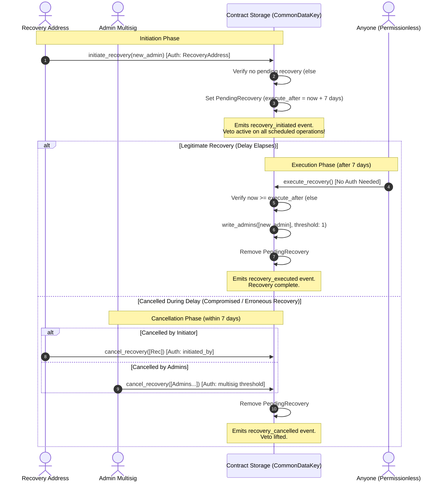

# Admin Recovery Lifecycle

This document defines the end-to-end administrator recovery lifecycle, authorization rules, timing guarantees, and failure modes across BettaPay smart contracts (`settlement_contract` and `governance_contract`).

---

## 1. Overview and Security Objectives

The admin recovery mechanism provides an emergency recovery pathway when active admin keys are lost, compromised, or unresponsive.

Key safety properties:
- **Separation of Roles**: The emergency recovery address (`RecoveryAddress`) can only initiate a recovery proposal; it cannot unilaterally execute changes immediately.
- **Mandatory Cooldown**: An immutable 7-day timelock delay (`RECOVERY_DELAY_SECONDS`) gives existing administrators time to detect and cancel illegitimate recovery attempts.
- **Emergency Timelock Veto**: In `settlement_contract`, a pending recovery immediately freezes all queued scheduled administrative operations (such as code upgrades or admin transfers) from executing.
- **Permissionless Finalization**: Once the delay window elapses, any caller can execute the recovery, guaranteeing finalization even if the recovery initiator loses connectivity.

---

## 2. Actors and Responsibilities

| Actor | Identification | Authorization / Entry Points | Responsibilities |
|---|---|---|---|
| **Recovery Address** | Singleton `Address` stored in `CommonDataKey::RecoveryAddress` | `initiate_recovery(env, new_admin)`<br>`cancel_recovery(env, signers)` | Initiates emergency recovery proposing `new_admin`. Can cancel its own in-flight initiation. |
| **Admin Multisig** | Stored in `DataKey::Admin` with multisig `CommonDataKey::Threshold` | `cancel_recovery(env, signers)`<br>`update_recovery_address(env, signers, new_rec)` | Active administrators. Can cancel unauthorized recovery attempts or rotate the recovery address. |
| **Permissionless Executor** | Any caller / network relayer / keeper bot | `execute_recovery(env)` | Calls `execute_recovery` once the 7-day delay has elapsed. Requires no signatures. |

---

## 3. End-to-End Recovery Flow



### Detailed Flow Steps

### 1. Initiation: `initiate_recovery(env, new_admin)`
- **Caller**: Must be the stored `recovery_address` (`recovery_address.require_auth()`).
- **Input**: Target `new_admin: Address` (must not be the zero-address).
- **Checks**:
  - The contract must be initialized.
  - If a recovery is already pending (`CommonDataKey::PendingRecovery` exists in instance storage), it panics with `SettlementError::RecoveryAlreadyPending` (Error code `15`). Overwriting an in-flight recovery is strictly prohibited.
- **Storage Update**: Writes `PendingRecovery` to instance storage:
  ```rust
  pub struct PendingRecovery {
      pub new_admin: Address,
      pub execute_after: u64,     // env.ledger().timestamp() + RECOVERY_DELAY_SECONDS
      pub initiated_by: Address,  // recovery_address
  }
  ```
- **Events**: Emits `recovery_initiated` with topics `(Symbol("recovery_initiated"), recovery_address, new_admin)` and data `execute_after`.
- **Scheduled Operation Veto**: Writing `PendingRecovery` activates an immediate veto over all queued scheduled operations in `settlement_contract`.

### 2. Timelock Delay Period
- **Delay Constant**: `RECOVERY_DELAY_SECONDS = 7 * 24 * 60 * 60` (7 days / 604,800 seconds).
- **Execution Condition**: Execution is blocked until `env.ledger().timestamp() >= pending.execute_after`.
- During this window, the recovery can be cancelled if triggered in error or maliciously.

### 3. Cancellation: `cancel_recovery(env, signers)`
A pending recovery can be cancelled through two valid authorization paths:
1. **Initiator Path**: `signers` consists solely of the address stored in `pending.initiated_by`. Validated via `pending.initiated_by.require_auth()`.
2. **Admin Multisig Path**: `signers` contains valid administrators meeting the contract's multisig `Threshold`. Validated via `verify_admin_auth(&env, &signers, threshold)`.
- Any other caller or insufficient signer set panics with `SettlementError::Unauthorized` (Error code `3`).
- If no recovery is pending, panics with `SettlementError::RecoveryNotPending` (Error code `8`).
- **Storage Update**: Removes `CommonDataKey::PendingRecovery` from instance storage.
- **Events**: Emits `recovery_cancelled` with the cancelling address.
- **Effect**: Lifts the veto on scheduled operations.

### 4. Execution: `execute_recovery(env)`
- **Caller**: Permissionless. Anyone can call this method once `execute_after` has arrived.
- **Checks**:
  - If no recovery is pending: panics with `SettlementError::RecoveryNotPending` (Error code `8`).
  - If `env.ledger().timestamp() < pending.execute_after`: panics with `SettlementError::RecoveryDelayActive` (Error code `9`).
- **Storage Update**:
  - `settlement_contract`: Sets `DataKey::Admin` to `vec![pending.new_admin]` and `CommonDataKey::Threshold` to `1` (`write_admins`).
  - `governance_contract`: Sets `DataKey::Admin` to `pending.new_admin`.
  - Removes `CommonDataKey::PendingRecovery` atomically from instance storage.
- **Events**: Emits `recovery_executed` with payload `AdminTransferred { old_admin, new_admin }`.

---

## 4. Failure Modes and Error Codes

| Error Variant | Numeric Code | Triggering Condition |
|---|---|---|
| `RecoveryNotPending` | `8` | `execute_recovery` or `cancel_recovery` called when `CommonDataKey::PendingRecovery` is absent from storage. |
| `RecoveryDelayActive` | `9` | (1) `execute_recovery` called before `env.ledger().timestamp() >= execute_after`.<br>(2) `settlement_contract::execute()` called on any scheduled operation (except `CancelRecovery`) while `PendingRecovery` is present. |
| `RecoveryAlreadyPending` | `15` | `initiate_recovery` called when a pending recovery is already registered in storage. |
| `Unauthorized` | `3` | `cancel_recovery` called by an address that is neither `initiated_by` nor a quorum of current admins. |
| `InvalidAdmin` | `6` | `initiate_recovery` called with zero-address as `new_admin`. |
| `InvalidRecoveryAddress` | `7` | `update_recovery_address` called with zero-address. |

---

## 5. Settlement vs Governance Contract Recovery Differences

While both contracts share the `CommonDataKey::PendingRecovery` schema and events from `bettapay_common`:

| Feature / Behavior | Settlement Contract (`settlement_contract`) | Governance Contract (`governance_contract`) |
|---|---|---|
| **Admin Storage Shape** | Multisig `Vec<Address>` under `DataKey::Admin` and `u32` threshold under `CommonDataKey::Threshold`. | Single `Address` under `DataKey::Admin`. |
| **Execution State Change** | Replaces admin vector with `vec![new_admin]` and resets `Threshold` to `1`. | Sets `Admin` to `new_admin`. |
| **Scheduled Operations Veto** | **Yes**: Active `PendingRecovery` vetoes all queued timelocked operations in `execute()` (except `CancelRecovery`). | **N/A**: Governance does not maintain a timelocked operation queue. |
| **Timelocked CancelRecovery** | Can be queued and executed via timelock (`Operation::CancelRecovery`) without recovery address or active admin keys. | Direct entry point only. |
